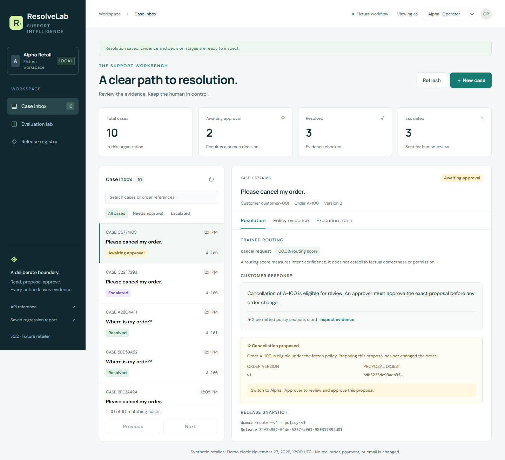

# ResolveLab

An evaluated support workbench for a fictional online retailer. Operators inspect a trained route and versioned policy evidence, resolve tracking questions, prepare cancellations for human approval, or create a handoff. A model never authorizes an order change.

**Live v0.3.0:** [Open ResolveLab](https://resolvelab-blush.vercel.app). The FastAPI backend and private evaluation consumer run on Vercel, with restricted Neon PostgreSQL roles, separate serving/evaluation databases, and Neon Managed Better Auth. A real verified owner identity is explicitly enrolled as an Alpha administrator. Public signup does not grant a membership; production fixture login is disabled. The retailer, orders and policies remain synthetic demonstration data.



**Implemented:** FastAPI API, PostgreSQL migrations and tenant isolation, trained routing, lexical/dense/hybrid retrieval, structured responses, local approval transactions, durable traces, evaluation worker, release rollback, browser interface, repeatable fixtures, backup restore check and CI.

**Current verification:** 210 native Windows/PostgreSQL tests passed without failures or skips after the provider-cookie fix; the 210-test GitHub-hosted Linux CI run is also green. The frontend review passed 69 ResolveLab checks against the real frontend with intercepted provider/API responses. It includes 35 ResolveLab account-form accessibility scans; the combined ResolveLab/OrderFlow total is 65, not 65 ResolveLab scans. These checks are separate from the live provider/account proof and do not establish full WCAG conformance. A fresh exported-snapshot restore matched all **22 tables**, including populated durable evaluation report/outbox tables, and verified tracking and approval in an owned disposable database. [Native proof](artifacts/production-v0.3/checks/auth-cookie-fix/native-full.source-proof.json) · [Backup proof](artifacts/production-v0.3/backup/verification.json) · [Production scope](docs/PRODUCTION.md).

**Historical v0.2.1:** The sealed review and its original test, browser and 20-table recovery evidence remain available in [the review note](docs/REVIEW-2026-11-23.md). Its hosted/IdP and Linux availability limits describe that earlier release, rather than the current deployment.

A separate actual **Neon PostgreSQL 18.7 application-schema restore** also matched all 22 table hashes and restored 20 forced-RLS tables, with restricted-role isolation and owned database/dump cleanup verified. Managed authentication, warehouse and evaluation data were excluded. See the [bounded cloud recovery addendum](docs/CLOUD-RECOVERY-2026-11-23.md).

The frozen v4 router achieved **0.8705 macro-F1 and 139/160 correct intents on a separately authored synthetic holdout**. Full workflow success was also **139/160 (86.9%)**. It accepted 104 routes, including **4 wrong accepted routes**; **1/40 unsupported requests was accepted**. All 160 order-effect audits completed with **zero unauthorized effects observed**. Seventeen supported requests were over-escalated. These are small, agent-authored synthetic tests, not customer accuracy or a reliability guarantee. [Inspect every outcome](artifacts/v4/blind-final/workflow-evaluation.html).

On the **same 160 cases**, retained v1/v3/v4 releases completed 76/95/139 expected workflows respectively. This paired comparison is distinct from older 80- and 100-case audits. Historical failures, models and provenance remain available. See the [model card](docs/MODEL_CARD.md) and [analysis](artifacts/v4/analysis.json).

The five frozen evaluations were refreshed before the final auth-cookie patch: V4/V3/V1 retained **139/95/76 of 160**, the baseline retained **19/20**, and deterministic invariants passed **20/20**. All 520 effect audits completed with zero runner errors or unauthorized effects observed. Those reports retain their original whole-backend hash. The final 210-test proof and [component attestation](artifacts/production-v0.3/checks/auth-cookie-fix/ml-component-attestation.json) identify the later cookie-proxy change and verify that the model, retrieval, worker, fixture and evaluation components stayed unchanged. No weights, thresholds or evaluation cases were tuned.

Production uses the same-origin Neon Auth proxy and verifies Ed25519 JWT signatures, issuer, audience and expiry before resolving a server-maintained membership. Token-supplied roles do not grant permissions. Generic OIDC Authorization Code + PKCE remains supported for separately configured providers. Actual Vercel-to-private-Queue-to-Neon evaluations completed both a 20-case invariant job and a 20-case live-model job, with durable database reports and unchanged serving business data. Those jobs used an explicitly reviewed internal precondition; they are separate from an enrolled-user HTTP job-submission test. No real merchant connector or paid-provider benchmark is claimed.

## Run on Windows

Prerequisites: Python 3.12, PostgreSQL 17 command-line tools, and uv. The verified environment used Python 3.12.14, PostgreSQL 17.12 and uv 0.11.25. The lockfile fixes library versions. Setup downloads pinned public source files; the running fixture demo needs no paid provider or external merchant account.

```powershell
.\scripts\local.ps1 setup
uv sync --frozen --group dev
.venv\Scripts\python.exe scripts/populate_demo.py
.\scripts\local.ps1 run
```

Open **http://127.0.0.1:8000**. Start `.\scripts\local.ps1 worker` in another terminal for queued evaluations. The bootstrap creates its own loopback-only cluster at `.runtime/postgres`, port 55439, with separate serving, test and evaluation databases. It generates ignored local secrets; no existing user database is used.

If PostgreSQL is installed elsewhere, set `PG_BIN` to its `bin` directory. API reference is at `/docs`; readiness is `/health/ready`. The fixture clock is fixed to **2026-11-23 12:00 UTC** so cancellation deadlines remain reproducible.

## Inspect the main workflow

1. Select **Alpha · Operator**. Open the pending cancellation example, inspect Policy evidence and Execution trace. Or create a case with “Please cancel my order.” and order reference `A-100`.
2. The result stops at **Awaiting approval**. Switch to **Alpha · Approver**, inspect the same proposal and approve it. One approval, one order version change and one action receipt commit together.
3. Ask “Where is my order?” for `A-101` to inspect an authorized tracking answer. Ask for a refund or a human agent to inspect escalation. The preloaded failed case demonstrates a preserved provider-timeout trace and retry.
4. Switch to **Beta · Operator** to inspect the separate organization. Alpha's objects are unavailable through direct API reads as well as the inbox.
5. Select **Alpha · Evaluator** to queue the same fixture set for retained releases. The worker runs in a different database and preserves the inbox.

For a case awaiting information, attach an order reference to the same case, then explicitly resolve again. The customer and release stay pinned; the new reference does not establish ownership. An approver can decline a pending proposal with a fixed reason, producing an escalation and immutable decision trace without executing the cancellation. Both paths require the expected case version and idempotency key. See [v0.2 hardening](docs/HARDENING.md).

These signed local fixture identities are disabled outside `APP_ENV=local`. The hosted app uses Neon Auth and registered server-side memberships. See [production setup](docs/PRODUCTION.md).

## Reproduce checks and model results

```powershell
.\scripts\local.ps1 test
.\scripts\local.ps1 evaluate
.venv\Scripts\python.exe scripts/evaluate.py --dataset v4-blind-v1 --mode live_model --release-id 84f8a907-04de-5257-af61-98f317392d01 --output artifacts/v4/blind-final
.venv\Scripts\python.exe scripts/evaluate_retrieval_v2.py
.\scripts\local.ps1 backup-check
```

The independent workflow evaluation exits nonzero when any expected outcome fails; its current conservative routing failures are retained in the report. Deterministic invariants and trained-model quality are scored separately. Unknown provider cost and human citation-support review remain unavailable.

The trained artifacts and pinned MiniLM weights are included. Validate them with `python scripts/train_all.py`. `python scripts/train_all.py --rebuild` reproduces all training stages using grouped Bitext splits and the frozen domain-development families; it does not fit final evaluation cases. New bytes never overwrite an immutable named artifact. See [dataset provenance and leakage boundaries](docs/DATASET_CARD.md).

To record the browser journey, provision a new disposable fixture database with pending `A-100`, point the API and worker at it, and run:

```powershell
npm ci
npm run test:browser
npm run test:oidc
npm run test:ui-races
npm run test:features
npm run test:auth-callback
node scripts/operator-followup-check.mjs
npm run test:accessibility
```

Keep both the API and worker running for this check. The browser suite uses installed Google Chrome in an isolated headless session and writes screenshots, a WebM recording and JSON results under `artifacts/browser`. It checks tracking, evidence, trace, proposal, approval, handoff, release/evaluation screens, tenant switching and mobile overflow. It changes its disposable fixture order. Preserve any existing workspace database and use a fresh fixture database when repeating the cancellation journey.

## Docker

```text
python scripts/docker_env.py
docker compose --env-file .env.docker up --build -d
```

Compose includes API, worker, private PostgreSQL, one-shot migrations and durable named volumes. Only the API is published, on loopback. Generated `.env.docker` secrets are ignored. The earlier private Linux Docker startup smoke remains historical evidence in `artifacts/checks/linux-docker-smoke.json`; it is distinct from the current managed Vercel/Neon deployment. The public repository now runs free [GitHub Actions](https://github.com/nirajmohabey/resolvelab/actions), including Linux backend and container/browser jobs. An application test result does not audit the container or host operating system.

## Critical paths

| Area | Implementation / evidence |
|---|---|
| Atomic proposal approval and idempotency | `src/resolvelab/service.py`; `tests/test_security_and_transactions.py` |
| Neon Auth/OIDC, server-side membership and RLS | `neon_auth.py`, `auth.py`, `config.py`, `db.py`, security migrations |
| Immutable release pinning | `load_pinned_router`, `tests/test_pinned_artifacts.py`, `scripts/rollback.py` |
| Training and leakage checks | `scripts/train*.py`, `artifacts/*manifest*.json`, split membership |
| Release-pinned filtered retrieval | `src/resolvelab/retrieval.py`, `artifacts/retrieval-v2/report.json` |
| Evaluation and recoverable jobs | `queue_jobs.py`, `queue_worker.py`, `evaluate.py`, `worker.py`, serverless jobs migration |
| Recovery and operations | [Runbook](docs/RUNBOOK.md), `scripts/backup_check.py` |

[Architecture and decisions](docs/ARCHITECTURE.md) · [Data dictionary](docs/DATA_DICTIONARY.md) · [Model card](docs/MODEL_CARD.md) · [Dataset card](docs/DATASET_CARD.md) · [Third-party attribution](NOTICE.md)

[Release checks and limits](docs/CHECKS.md) · [Two-minute walkthrough](docs/DEMO.md) · [Case study](docs/CASE_STUDY.md)

For optional hidden background processes on Windows, use `scripts/background.ps1 start` and `scripts/background.ps1 stop`. PostgreSQL is managed separately. The model rollback verification command is `python scripts/verify_rollback.py`; it restores the original active pointer when finished. A full training rebuild may produce different serialized bytes despite identical metrics; promote those bytes under a new model version or use a disposable fixture reset rather than replacing an existing release.

The optional OpenAI Responses adapter is implemented and mock-tested, but has not been measured with a paid provider. It is deliberately restricted to the canonical supported answer; noncanonical drafts fail closed. Hosted authentication is real; retailer operations remain synthetic and do not execute real merchant orders, refunds or payments. Free-plan quotas, cold starts and provider availability remain operating limits. No uptime SLA, production capacity result or zero-vulnerability guarantee is claimed. MIT covers application source; dataset and model assets retain their original licenses.

[Production deployment](docs/PRODUCTION.md) · [Dependency audit](artifacts/security/README.md)
