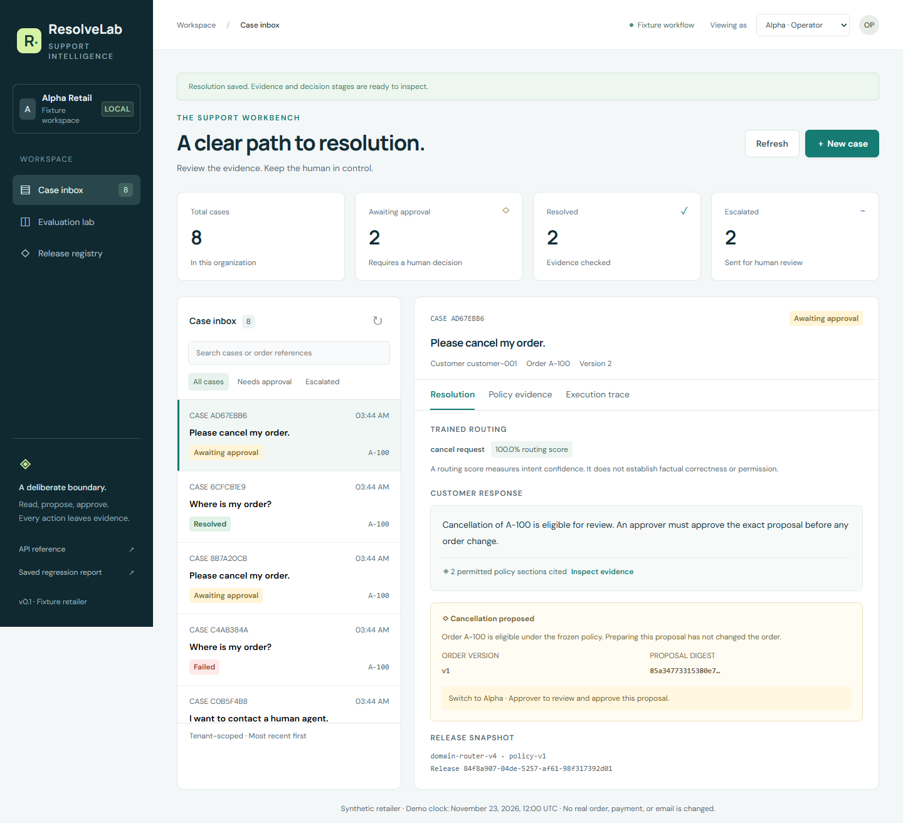

# ResolveLab

An evaluated support workbench for a fictional online retailer. Operators inspect a trained route and versioned policy evidence, resolve tracking questions, prepare cancellations for human approval, or create a handoff. A model never authorizes an order change.



**Implemented:** FastAPI API, PostgreSQL migrations and tenant isolation, trained routing, lexical/dense/hybrid retrieval, structured responses, local approval transactions, durable traces, evaluation worker, release rollback, browser interface, repeatable fixtures, backup restore check and CI.

**Verified locally:** 95 PostgreSQL-backed tests, including 25 repeated approval races and real process termination/recovery; 20/20 deterministic workflow regressions; nine operator browser checks; nine browser OIDC scenarios; ten UI race scenarios; zero automated accessibility violations across nine scanned states. The checks do not establish complete accessibility conformance or production identity-provider interoperability.

The frozen v4 router achieved **0.8705 macro-F1 and 139/160 correct intents on a separately authored synthetic holdout**. Full workflow success was also **139/160 (86.9%)**. It accepted 104 routes, including **4 wrong accepted routes**; **1/40 unsupported requests was accepted**. All 160 order-effect audits completed with **zero unauthorized effects observed**. Seventeen supported requests were over-escalated. These are small, agent-authored synthetic tests, not customer accuracy or a reliability guarantee. [Inspect every outcome](artifacts/v4/blind-final/workflow-evaluation.html).

On the **same 160 cases**, retained v1/v3/v4 releases completed 76/95/139 expected workflows respectively. This paired comparison is distinct from older 80- and 100-case audits. Historical failures, models and provenance remain available. See the [model card](docs/MODEL_CARD.md) and [analysis](artifacts/v4/analysis.json).

The workbench supports OIDC Authorization Code + PKCE for a configured provider. Production API tokens are signature-verified and mapped to server-maintained memberships; token-supplied roles do not grant permissions. A hardened TLS/OIDC deployment template is included. **A hosted backend, real merchant connector, real IdP integration and paid-provider benchmark have not been executed.** The portfolio uses the recorded local demonstration.

## Run on Windows

Prerequisites: Python 3.12, PostgreSQL 17 command-line tools, and uv. The verified environment used Python 3.12.14, PostgreSQL 17.12 and uv 0.11.25. The lockfile fixes library versions. Setup downloads pinned public source files; the running fixture demo needs no paid provider or external merchant account.

```powershell
uv sync --frozen
.\scripts\local.ps1 setup
.venv\Scripts\python.exe scripts/populate_demo.py
.\scripts\local.ps1 run
```

Open **http://127.0.0.1:8000**. Start `.\scripts\local.ps1 worker` in another terminal for queued evaluations. The bootstrap creates its own loopback-only cluster at `.runtime/postgres`, port 55439, with separate serving, test and evaluation databases. It generates ignored local secrets; no existing user database is used.

If PostgreSQL is installed elsewhere, set `PG_BIN` to its `bin` directory. API reference is at `/docs`; readiness is `/health/ready`. The fixture clock is fixed to **2026-11-23 12:00 UTC** so cancellation deadlines remain reproducible.

## Inspect the main workflow

1. Select **Alpha · Operator**. Open the pending cancellation example, inspect Policy evidence and Execution trace. Or create a case with “Please cancel my order.” and order reference `A-100`.
2. The result stops at **Awaiting approval**. Switch to **Alpha · Approver**, inspect the same proposal and approve it. One approval, one order version change and one action receipt commit together.
3. Ask “Where is my order?” for `A-101` to inspect an authorized tracking answer. Ask for a refund or a human agent to inspect escalation. The preloaded failed case demonstrates a preserved provider-timeout trace and retry.
4. Switch to **Beta · Operator** to inspect the separate organization. Alpha's objects are unavailable through direct API reads as well as the inbox.
5. Select **Alpha · Evaluator** to queue the same fixture set for retained releases. The worker runs in a different database and preserves the inbox.

These signed local fixture identities are disabled outside `APP_ENV=local`. Production uses the separate OIDC flow and requires a real provider plus registered server-side memberships. See [production setup](docs/PRODUCTION.md).

## Reproduce checks and model results

```powershell
.\scripts\local.ps1 test
.\scripts\local.ps1 evaluate
.venv\Scripts\python.exe scripts/evaluate.py --dataset v4-blind-v1 --mode live_model --release-id 84f8a907-04de-5257-af61-98f317392d01 --output artifacts/v4/blind-final
.venv\Scripts\python.exe scripts/evaluate_retrieval_v2.py
.\scripts\local.ps1 backup-check
```

The independent workflow evaluation exits nonzero when any expected outcome fails; its current conservative routing failures are retained in the report. Deterministic invariants and trained-model quality are scored separately. Unknown provider cost and human citation-support review remain unavailable.

The trained artifacts and pinned MiniLM weights are included. Validate them with `python scripts/train_all.py`. `python scripts/train_all.py --rebuild` reproduces all training stages using grouped Bitext splits and the frozen domain-development families; it does not fit final evaluation cases. New bytes never overwrite an immutable named artifact. See [dataset provenance and leakage boundaries](docs/DATASET_CARD.md).

To record the browser journey, use a clean fixture reset with pending `A-100`, start the API, and run:

```powershell
npm ci
npm run test:browser
npm run test:oidc
npm run test:ui-races
npm run test:accessibility
```

Keep both the API and worker running for this check. The browser suite uses installed Google Chrome in an isolated headless session and writes screenshots, a WebM recording and JSON results under `artifacts/browser`. It checks tracking, evidence, trace, proposal, approval, handoff, release/evaluation screens, tenant switching and mobile overflow. It changes the local fixture order. Reset fixtures explicitly before repeating the cancellation journey.

## Docker

```text
python scripts/docker_env.py
docker compose --env-file .env.docker up --build -d
```

Compose includes API, worker, private PostgreSQL, one-shot migrations and durable named volumes. Only the API is published, on loopback. Generated `.env.docker` secrets are ignored. CI includes a container-build/readiness smoke job and a separate PostgreSQL acceptance job. GitHub prevented the initial jobs from starting because of an account runner restriction, so Docker and clean-Linux execution remain unverified. Native Windows/PostgreSQL checks passed. This release does not create billable cloud resources.

## Critical paths

| Area | Implementation / evidence |
|---|---|
| Atomic proposal approval and idempotency | `src/resolvelab/service.py`; `tests/test_security_and_transactions.py` |
| OIDC, server-side membership and RLS | `auth.py`, `config.py`, `db.py`, `migrations/versions/0002_security.py` |
| Immutable release pinning | `load_pinned_router`, `tests/test_pinned_artifacts.py`, `scripts/rollback.py` |
| Training and leakage checks | `scripts/train*.py`, `artifacts/*manifest*.json`, split membership |
| Release-pinned filtered retrieval | `src/resolvelab/retrieval.py`, `artifacts/retrieval-v2/report.json` |
| Evaluation and recoverable jobs | `evaluate.py`, `worker.py`, `scripts/evaluate.py` |
| Recovery and operations | [Runbook](docs/RUNBOOK.md), `scripts/backup_check.py` |

[Architecture and decisions](docs/ARCHITECTURE.md) · [Data dictionary](docs/DATA_DICTIONARY.md) · [Model card](docs/MODEL_CARD.md) · [Dataset card](docs/DATASET_CARD.md) · [Third-party attribution](NOTICE.md)

[Release checks and limits](docs/CHECKS.md) · [Two-minute walkthrough](docs/DEMO.md) · [Case study](docs/CASE_STUDY.md)

For optional hidden background processes on Windows, use `scripts/background.ps1 start` and `scripts/background.ps1 stop`. PostgreSQL is managed separately. The model rollback verification command is `python scripts/verify_rollback.py`; it restores the original active pointer when finished. A full training rebuild may produce different serialized bytes despite identical metrics; promote those bytes under a new model version or use a disposable fixture reset rather than replacing an existing release.

The optional OpenAI Responses adapter is implemented and mock-tested, but has not been measured with a paid provider. It is deliberately restricted to the canonical supported answer; noncanonical drafts fail closed. No real order, payment, email, merchant connector or public backend deployment is claimed. MIT covers application source; dataset and model assets retain their original licenses.

[Production deployment](docs/PRODUCTION.md) · [Dependency audit](artifacts/security/README.md)
