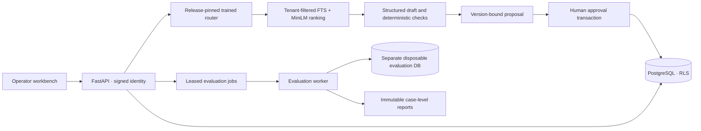

# Architecture and guarantees

ResolveLab helps a support operator track an owned fixture order, prepare a cancellation, or create an internal handoff. It has no merchant, payment, or email integration.

The API and worker use a nonowner PostgreSQL role without superuser or BYPASSRLS. Every runtime transaction sets tenant and actor context with transaction-local settings. Tables enforce tenant policies and composite tenant foreign keys. Membership is re-read from the database; neither a body field nor a stale token grants a role.

Every case pins a model artifact SHA, corpus, prompt and tool policy. Both retrieval methods apply tenant, selected published corpus and document access filters before ranking. Evidence snapshots remain attached to resolutions. Citation existence, answer support and action eligibility are distinct checks.

Inference and provider HTTP calls occur outside database row locks. A final short transaction rechecks versions and evidence. Cancellation approval locks the proposal, case and order; verifies the exact proposal digest, case/order versions, customer ownership, role, policy and deadline; then writes approval, order change, action receipt, traces and idempotent result together. Unique constraints prevent a second effect. Repeated keys bind their canonical payload and resource identity.

This atomic guarantee applies to the local fixture connector only. A future remote connector needs provider idempotency and an explicit unknown-outcome/reconciliation protocol. A database key cannot remove uncertainty after a remote timeout.

Evaluation jobs never reset the serving database. A session advisory lock serializes evaluation subprocesses, job leases expire after 15 minutes, execution is bounded to 12 minutes, and a lease token fences stale completion. Three exhausted attempts leave a visible failed job.

## Decisions

| Choice | Reason | Cost or limit |
|---|---|---|
| PostgreSQL row locks and RLS | Inspectable local transactions and defense against tenant query errors | Correct runtime role and per-transaction context are essential |
| Exact MiniLM vector ranking | Four policy sections do not justify an approximate index | Linear scan is bounded to this small permitted corpus |
| Logistic routing baseline and domain challenger | Cheap, reproducible training plus measurable errors | Conservative gate escalates unfamiliar wording |
| Reciprocal rank fusion, k=60 | Simple reproducible hybrid baseline | Dense-only ranked better on the 16-query fixture; hybrid is not claimed superior |
| Canonical answer validation | Unsupported provider prose cannot introduce a factual claim | The optional provider adapter rejects noncanonical rewrites; it is deliberately narrow |
| Separate serving, evaluation and test DBs | A test/reset cannot erase operator cases | Extra local databases and explicit administration credentials |

See `src/resolvelab/service.py` for the critical transaction and `tests/test_security_and_transactions.py` for races, rollback and isolation evidence.
